 

 

♡ ˚ ༘ ⋆｡˚ ✧ ˚｡⋆ ༘ ˚ ♡

## 🌸 Sobre mim

Oi, eu sou a **Agatha**! 💗

Estudo **Técnico em Desenvolvimento de Sistemas** no **Senac** e me apaixonei por **front-end**: gosto de transformar ideias em interfaces **bonitas, acessíveis e que funcionam bem em qualquer tela**. Também estou explorando **programação** e **bancos de dados**, porque por trás de toda tela bonita existe um sistema bem pensado. ✨

> Entre um café e um `display: flex`, eu vou deixando a web um pouquinho mais bonita. 🎀

 

## 🎀 O que estou fazendo agora

| | Foco | No momento |
|:---:|:---|:---|
| 💻 | **C# e .NET** | Praticando **Programação Orientada a Objetos** e boas práticas de código |
| 🗄️ | **Bancos de dados** | Estudando **SQL**, **MariaDB** e modelagem de dados relacionais |
| 🌐 | **APIs e front-end** | Construindo uma base sólida para conectar interfaces a sistemas reais |
| 🔧 | **Projetos** | Colocando tudo em prática em projetos acadêmicos e pessoais |

 

## 📚 Minha jornada

- 🎓 **Técnico em Desenvolvimento de Sistemas** — Senac *(cursando)*
- 💻 Desenvolvendo projetos com **C#** e **.NET**
- 🗄️ Aprendendo **modelagem de dados** e **SQL**
- 🧠 Estudando **POO** e boas práticas de desenvolvimento

🚀 **Objetivo:** me tornar desenvolvedora **full stack**, unindo **interfaces bonitas** a **sistemas bem estruturados**.

 

## ✨ Tecnologias & ferramentas

### Linguagens e desenvolvimento

### Bancos de dados

### Ferramentas

 

## 🌷 Objetivos

- 🧩 Fortalecer minha **lógica de programação**
- 🎨 Aprender **desenvolvimento front-end** e **construção de APIs**
- 🗄️ Aprofundar meus conhecimentos em **SQL** e **MariaDB**
- 💻 Evoluir em **C# e .NET**, sempre com boas práticas de programação
- 🧠 Estudar **arquitetura de software** e **sistemas escaláveis**
- 🚀 Construir uma carreira sólida como **desenvolvedora full stack**

 

## 📊 Meu GitHub

 

*Cada commit é um passinho nessa jornada.* 🌸

 

## 💌 Vamos conversar?

 

*"Código bonito começa com um layout bem alinhado."* 🎀

  

